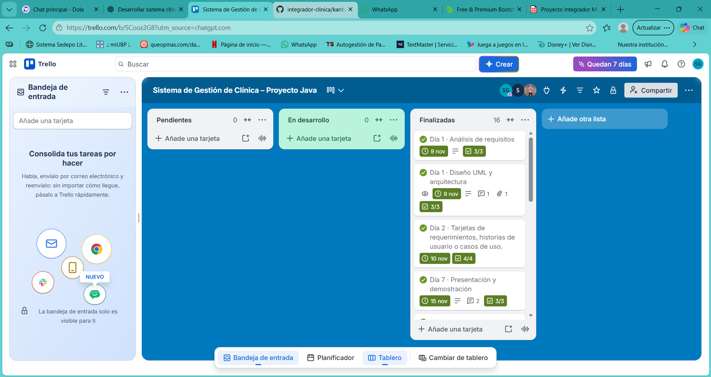

# Clínica San Bernardito
**Integrantes:** Verónica Soledad Gonzáles (Sole-Gonzales), Bautista Valentín Sayhueque Garcia Segovia (say-gs), Santiago Giustolisi (SantiagoGiustolisi)

**Tablero Kanban:** https://trello.com/b/SCooz2G8

## Descripción del negocio
La clínica San Bernardito es una institución dedicada a brindar servicios de atención médica, ofreciendo asistencia profesional y personalizada para cada paciente.

## Problema que resuelve
Nuestro programa se encargará de organizar y gestionar a los pacientes y sus turnos médicos. 
Este sistema permite llevar un registro de los pacientes mediante su DNI, asignarles turnos normales o urgentes y organizar las prioridades de atención.

## Tema elegido
Clase 8: Sets, Queues & Stacks. Elegimos este tema porque nos gustó la idea de realizar un programa que pudiera organizar los turnos de pacientes que cuando tuvieran una urgencia, el mismo programa les dé prioridad por sobre pacientes que solo vienen por chequeos regulares.

## Tecnologías
-Eclipse, Java
-Trello

## Requisitos

Para ejecutar el sistema se necesita:

- Java JDK instalado.
- Eclipse IDE con soporte para Java.
- Git (opcional, para clonar el repositorio).

## Instalación

1. Ingresar al repositorio: https://github.com/say-gs/integrador-clinica
2. Seleccionar **Code → Download ZIP**.
3. Descomprimir el archivo descargado.
4. Abrir Eclipse IDE.
5. Seleccionar **File → Import → General → Existing Projects into Workspace**.
6. Elegir la carpeta descomprimida del proyecto y finalizar la importación.

## Ejecución

1. En Eclipse, abrir la carpeta `src`.
2. Buscar el archivo `Main.java`.
3. Hacer clic derecho sobre `Main.java`.
4. Seleccionar **Run As → Java Application**.
5. Utilizar el menú de la consola para interactuar con el sistema.

## Funcionalidades

El sistema permite:

1. Registrar pacientes evitando DNI duplicados.
2. Asignar turnos normales por orden de llegada (FIFO).
3. Asignar turnos urgentes según su prioridad.
4. Atender al siguiente paciente, priorizando las urgencias.
5. Deshacer la última operación registrada.
6. Salir del sistema.

## Estructuras de datos utilizadas

El sistema utiliza cuatro estructuras de datos principales de Java:

- **HashSet:** permite registrar los DNI de los pacientes y evitar duplicados.
- **Queue:** organiza los turnos normales por orden de llegada (FIFO), es decir, el primero en ingresar es el primero en ser atendido.
- **PriorityQueue:** organiza los turnos urgentes según su nivel de prioridad. Cuando dos pacientes tienen la misma prioridad, se respeta el orden de llegada.
- **Stack:** permite almacenar operaciones para utilizar la función de deshacer.
- Además, utilizamos **HashMap** para relacionar el DNI de cada paciente con sus datos registrados.

## Pruebas funcionales

Para comprobar el funcionamiento del sistema, realizamos diez casos de prueba que permiten verificar las principales funcionalidades del programa.

Las pruebas incluyen el registro de pacientes, la detección de DNI duplicados, la asignación y atención de turnos normales, la gestión de urgencias según su prioridad y la función de deshacer operaciones.

También se verificó el comportamiento del sistema ante distintas situaciones de uso.

Los diez casos de prueba están documentados en el archivo [CASOS_DE_PRUEBA.md](pruebas/CASOS_DE_PRUEBA.md).

## Conclusiones

El desarrollo del sistema Clínica San Bernardito nos permitió aplicar los conocimientos adquiridos sobre programación orientada a objetos y estructuras de datos en Java.

Aprendimos a utilizar HashSet para evitar registros duplicados, Queue para organizar turnos normales, PriorityQueue para priorizar urgencias y Stack para implementar la función de deshacer.

También fortalecimos el trabajo en equipo mediante GitHub para el control de versiones y Trello para organizar las tareas.

Las pruebas funcionales nos permitieron comprobar el comportamiento del programa y corregir aspectos de su funcionamiento.

Como mejora futura, podríamos incorporar una interfaz gráfica, guardar los datos de manera permanente y agregar nuevas funcionalidades para la gestión de la clínica.

## Capturas del proyecto

### Tablero Kanban final

La siguiente captura muestra el estado final del tablero Trello, con las 16 tareas del proyecto finalizadas.

Las capturas correspondientes a las siete jornadas de trabajo se encuentran disponibles en la carpeta [kanban](kanban/).
