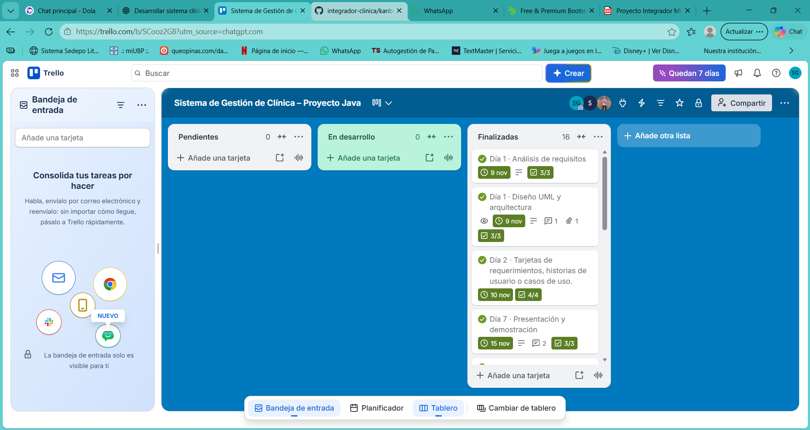

## Día 1 (9/11/2026)
- Qué hicimos: Hoy realizamos el tablón de Trello con el cronograma y todas las actividades pendientes, junto con la bitácora y el README.
  
- Quién hizo qué: Verónica realizo el cronograma en Trello, mientras que Bautista y Santiago hicieron la parte del repositorio que incluye la bitácora y el archivo README
  
- Qué nos trabó: La interfaz de Github
  
- Qué sigue: Mañana realizaremos parte del código del programa que permitirá organizar a los pacientes por urgencia.
  
- Captura del tablero: 

## Día 2 (10/11/2026)
- Qué hicimos: Se creo la carpeta docs, con el archivo de análisis para comenzar a mostrar el diagrama de clases, modelo  de datos, etc.
  
- Quién hizo qué: Santiago Giustolisi, se encargó de la creación de las carpetas indicadas.
  
- Qué nos trabó: Establecer que colocar en los archivos dentro de docs, en análisis, modelos de datos.

- Qué sigue: Comenzar a crear carpeta /src donde se comenzara a desarrollar el código correspondiente al sistema, además se va a realizar un diagrama de clases, modelo de datos o bocetos dentro de la carpeta docs.

- Captura del tablero: 

## Día 2 (10/11/2026) – Turnos normales con Queue

- Qué hicimos: Avanzamos en el desarrollo del sistema de gestión clínica en Java. Implementamos y probamos la gestión de turnos normales mediante la estructura Queue<Turno> utilizando ArrayDeque. Verificamos el funcionamiento de los métodos offer() y poll(), respetando el orden FIFO (primero en entrar, primero en salir).

- Quién hizo qué: Verónica Soledad González trabajó en la implementación y prueba de los turnos normales, revisó la compatibilidad de las clases Paciente, Turno y SistemaClinica, creó la rama Turnos-Normales en GitHub y subió la clase Turno.java al repositorio remoto.

- Qué nos trabó: Encontramos dificultades al importar el repositorio en Eclipse, corregir la extensión del archivo `Turno.java` y configurar la autenticación de GitHub para subir los cambios. Logramos resolver estos inconvenientes.

- Qué sigue:Continuaremos con la integración de Queue<Turno> en la versión compartida de SistemaClinica.java, coordinaremos los cambios con los demás integrantes y prepararemos la Pull Request para incorporar el trabajo a la rama principal.
 
 
## Día 3 (11/11/2026)
- Qué hicimos: Se realizo el diseño del sistema, el diagrama de clases y se creó la carpeta src con las clases Main, Paciente, Turno y SistemaClinica.
  
- Quién hizo qué: Santiago se encargó de redactar el documento con el diseño del sistema, Verónica realizó el diagrama de clases y Bautista creó la carpeta src con sus clases.
  
- Qué nos trabó: Nos costó un poco armar el diseño del sistema, pero pudimos hacerlo sin mucho problema.
  
- Qué sigue: A partir de mañana nos centraremos en escribir el código.
  
- Captura del tablero: 

## Día 4 (12/11/2026)
- Qué hicimos: Se programó la gestión de urgencias utilizando PriorityQueue junto con un Comparator para ordenar por gravedad y desempatar por orden de llegada, además de corregir las extensiones .java y realizar las pruebas en consola.
  
- Quién hizo qué: Santiago se encargó de completar la clase Turno, implementar el Comparator en SistemaClinica y ejecutar las pruebas desde Main.java.
  
- Qué nos trabó: Configurar el entorno para ejecutar Java y corregir los archivos que no tenían la extensión .java asignada.
  
- Qué sigue: Implementar la cola de turnos normales con Queue, el historial de deshacer con Stack y armar el menú interactivo de consola.
  
- Captura del tablero: 

 ## Día 5 (13/11/2026)
 - Qué hicimos: Se completó la integración de las clases Paciente, Turno y SistemaClinica, se añadió el historial para deshacer acciones con Stack y se corrigieron errores en el código.
   
 - Quién hizo qué: Bautista añadió el historial para deshacer, junto con la cola Queue para añadir turnos normales, Verónica integró las clases Paciente, Turno y SistemaClinica, se encargó de corregir los errores y realizar pruebas en la clase Main.

 - Qué nos trabó: Implementar el historial de deshacer acciones y coordinarlo con las colas de turnos.
   
 - Qué sigue: Completar la clase Main con la interfaz/menú de consola y realizar las tarjetas de pruebas.
   
 - Captura del tablero: 

## Día 6 (14/11/2026)
- Qué hicimos: Se implementó el menú interactivo de consola completo en la clase Main.java, conectando todas las opciones con los módulos de SistemaClinica y agregando validaciones de entrada para evitar errores al ingresar datos.
  
- Quién hizo qué: Santiago se encargó de programar la interfaz de consola en Main.java, validar el ingreso de datos por teclado (números, rangos de edad, prioridades y textos vacíos) y probar el flujo completo del sistema.
  
- Qué nos trabó: Asegurar que el programa no se detenga ante el ingreso de letras o valores fuera de rango en las opciones numéricas del menú.
  
- Qué sigue: Ejecutar las pruebas funcionales finales de punta a punta, corregir cualquier falla menor y preparar la documentación definitiva junto con la demostración del proyecto.
  
- Captura del tablero: 

 ## Día 7 (15/11/2026)

- **Qué hicimos:** Finalizamos la documentación del proyecto Clínica San Bernardito, actualizamos el diagrama UML y el README, revisamos los diez casos de prueba y organizamos la presentación final. Dimos por completado el ensayo grupal y cerramos todas las tareas del tablero Trello.

- **Quién hizo qué:** Verónica actualizó el diagrama UML y las instrucciones del README, revisó las pruebas y organizó la distribución de responsabilidades para la exposición. Santiago quedó a cargo de la introducción, el menú de consola y las urgencias con PriorityQueue. Bautista quedó a cargo de la arquitectura, el registro de pacientes con HashSet y la función deshacer con Stack. Verónica quedó a cargo de los turnos normales con Queue, las pruebas y la documentación.

- **Qué nos trabó:** Fue necesario revisar la documentación para asegurar que el diagrama UML coincidiera con las clases reales del programa y que las instrucciones de ejecución fueran claras.

- **Qué sigue:** Realizar la presentación final del proyecto mediante Zoom y responder las preguntas de la docente.

- **Captura del tablero:** 
